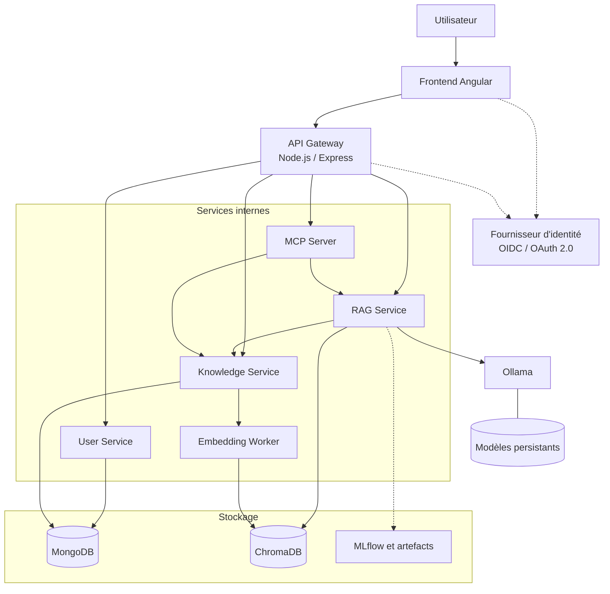

# Architecture générale de DevKnowledge

## 1. Objectif

DevKnowledge est une application métier locale destinée à organiser, classer, rechercher et exploiter les connaissances accumulées au cours de formations et de travaux pratiques.

L'application doit pouvoir conserver des notes, des extraits de code, des commandes, des solutions à des erreurs, des procédures techniques et des références documentaires.

Son assistant IA doit s'appuyer sur le corpus autorisé de l'utilisateur, citer ses sources et signaler explicitement lorsque les informations disponibles sont insuffisantes.

## 2. Principes d'architecture

- **Local-first :** l'application doit fonctionner localement sans dépendre d'un service cloud pour ses fonctions essentielles.
    
- **Séparation des responsabilités :** chaque service possède un périmètre métier explicite.
    
- **Point d'entrée unique :** le navigateur communique avec l'API Gateway, et non directement avec les microservices ou les bases de données.
    
- **API internes contrôlées :** les services communiquent par des interfaces documentées.
    
- **Sécurité par défaut :** authentification, autorisation, validation des entrées et gestion des secrets.
    
- **Traçabilité :** les décisions d'architecture, les tests et les procédures sont documentés dans Git.
    
- **IA vérifiable :** les réponses de l'assistant doivent présenter les références utilisées et reconnaître les limites du corpus.
    

## 3. Technologies envisagées

| Composant         | Technologie       | Responsabilité                                        |
| ----------------- | ----------------- | ----------------------------------------------------- |
| Frontend          | Angular           | Interface utilisateur                                 |
| API Gateway       | Node.js / Express | Point d'entrée HTTP, contrôle d'accès et routage      |
| User Service      | Python / FastAPI  | Profils, préférences et rôles applicatifs             |
| Knowledge Service | Python / FastAPI  | Gestion des connaissances                             |
| RAG Service       | Python / FastAPI  | Recherche documentaire et orchestration IA            |
| MCP Server        | Python / Fast MCP | Exposition contrôlée d'outils et de ressources        |
| Embedding Worker  | Python            | Calcul des embeddings et indexation                   |
| Base métier       | MongoDB           | Persistance des connaissances et données applicatives |
| Index vectoriel   | ChromaDB          | Recherche sémantique                                  |
| Runtime IA        | Ollama            | Inférence des modèles locaux                          |
| MLOps             | MLflow            | Suivi et évaluation des expérimentations              |

Ces technologies constituent la cible initiale. Leur version et leur configuration seront fixées au moment de l'implémentation.

## 4. Architecture logique

Le diagramme représente la cible fonctionnelle. Les composants seront déployés progressivement.

## 5. Règles de communication

- Angular appelle exclusivement l'API Gateway pour accéder aux fonctions métier.
    
- La Gateway applique les contrôles d'accès et route les requêtes.
    
- Le Knowledge Service est responsable des opérations sur les connaissances.
    
- Le RAG Service utilise le Knowledge Service et ChromaDB pour retrouver les informations pertinentes.
    
- Le RAG Service appelle Ollama pour générer une réponse à partir du contexte sélectionné.
    
- Le MCP Server expose uniquement les outils explicitement autorisés.
    
- Aucun service ne doit contourner les contrôles métier en accédant directement aux données d'un autre service.
    

## 6. Déploiement progressif

1. Socle de développement et services minimaux.
    
2. Persistance métier et CRUD des connaissances.
    
3. Identité et autorisations.
    
4. Indexation et recherche sémantique.
    
5. Assistant RAG et modèle local.
    
6. Intégration MCP.
    
7. Évaluation IA et MLOps.
    
8. Sécurité, observabilité et sauvegardes renforcées.
    
9. CI/CD et préparation à la production.
    

## 7. Points restant à valider

- Fournisseur d'identité local.
    
- Organisation exacte des bases MongoDB.
    
- Stratégie de sauvegarde distante.
    
- Versions des composants et compatibilité matérielle.
    
- Modèle local à utiliser selon les capacités de la machine.